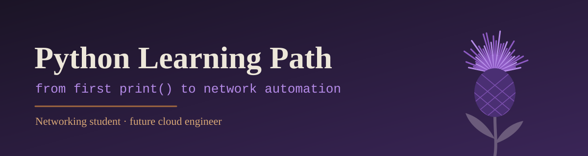

<p align="center">
  
</p>

<p align="center">
  
  
  
  
</p>

<p align="center">
  <a href="#about">About</a> •
  <a href="#roadmap">Roadmap</a> •
  <a href="#getting-started">Getting started</a> •
  <a href="#code-conventions">Conventions</a> •
  <a href="#resources">Resources</a> •
  <a href="#author">Author</a>
</p>

---

## About

My personal path to learning Python while studying **Computer Networks**. The goal is to become a **network analyst** and, later, a **cloud engineer**.

This repository combines two sources of study, so nothing gets done twice:

- the **university course** (Programming Languages), which sets the pace and the exam content;
- the **Ensina Dev Python path**, used for extra practice with instantly checked challenges.

Every exercise is saved here, together with small projects that apply Python to networking.

> Project status: **in progress**. New exercises are added as the course advances.

## Roadmap

- [ ] **Unit 1:** sequential structure (variables, data types, operators, input and output)
  - [x] Arithmetic operators and operator precedence
  - [ ] `input()` and `print()` exercises
  - [ ] Type conversion (`int`, `float`, `str`)
- [ ] **Unit 2:** conditional structures (`if`, `elif`, `else`)
- [ ] **Unit 3:** loops (`while`, `for`)
- [ ] **Unit 4:** data structures (lists, matrices, dictionaries)
- [ ] **Unit 5:** functions, scope, recursion and files
- [ ] **Networking projects**
  - [ ] Subnet calculator (network, broadcast and number of hosts)
  - [ ] IP address validator
  - [ ] Log file reader

Detailed status per topic is tracked in [progress.md](progress.md).


When the same exercise appears in both the textbook and the Ensina Dev path, I solve it only once and keep it in the folder where it fits best.

## Getting started

These steps let you run the code on your own machine.

### Prerequisites

- [Python 3](https://www.python.org/downloads/) (check with `python --version`)
- [Git](https://git-scm.com/)
- A code editor, such as [VS Code](https://code.visualstudio.com/)

### Installation

```bash
# 1. Clone the repository
git clone https://github.com/nicolle-assis/python-learning-path.git

# 2. Enter the folder
cd python-learning-path

# 3. Run any exercise
python unit01-sequential/extras/operator_precedence.py
```

On Windows, if `python` is not recognized, try `py` instead.

## Code conventions

- Code, comments, variable names and messages are written in **English**.
- Names follow **PEP 8**: `snake_case`, with the unit in the name when it helps (for example `height_cm`).
- Indentation uses **4 spaces**, never tabs.
- Commit messages are short and in the imperative, for example `Add unit 1 exercise 4: average of four grades`.

## Built with

- [Python 3](https://www.python.org/)
- [Visual Studio Code](https://code.visualstudio.com/)
- [Git](https://git-scm.com/) and [GitHub](https://github.com/)

## Resources

- University textbook: *Linguagem de Programação*, by Pietro Martins de Oliveira (Unicesumar)
- [Ensina Dev: Python path](https://ensinadev.com.br/trilhas/55675eef-b18c-421d-adb5-01ecb95aa57e)
- [Official Python tutorial](https://docs.python.org/3/tutorial/)
- [PEP 8: Style Guide for Python Code](https://peps.python.org/pep-0008/)

The textbook is protected by copyright and is not included in this repository.

## Author

Made by **[@nicolle-assis](https://github.com/nicolle-assis)**, a networking student learning to automate the things she used to do by hand.

## License

This project is under the MIT license. See the `LICENSE` file for details.

---

<p align="center"><sub>Built one commit at a time.</sub></p>